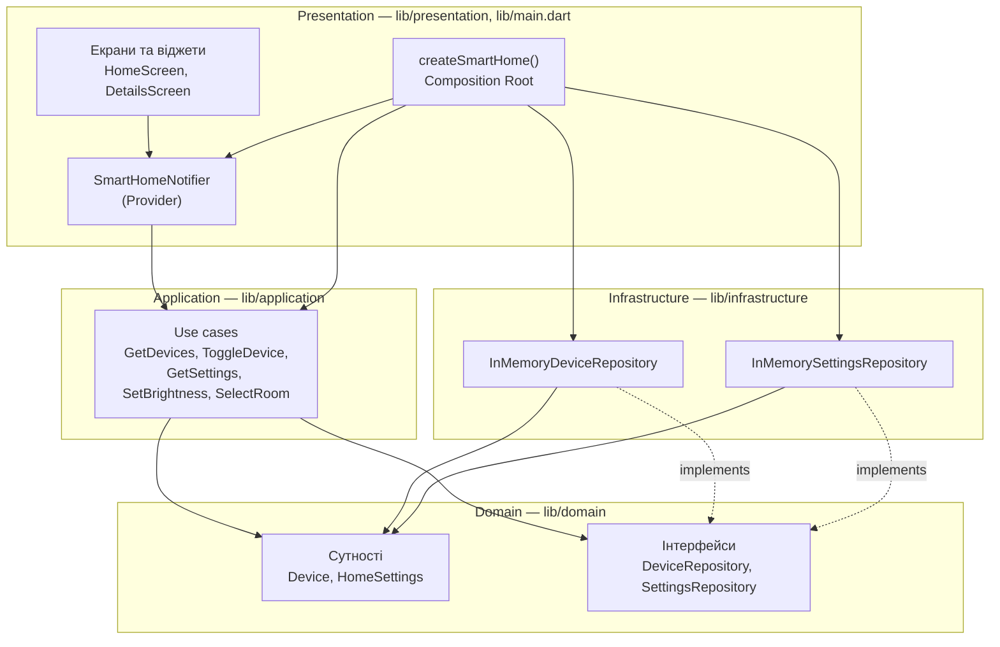

# Розумний дім — Clean Architecture

Flutter-застосунок «Розумний дім» (варіант 22) з лабораторних робіт № 3–4,
який у ЛР № 5 перебудовується за принципами **Clean Architecture**.

Застосунок дозволяє вмикати й вимикати пристрої, обирати активну кімнату,
регулювати яскравість освітлення та переглядати стан будинку на екрані деталей.

## Політика гілок

| Гілка        | Призначення                                                       |
|--------------|-------------------------------------------------------------------|
| `main`       | лише стабільний код, кожен реліз позначається тегом `vX.Y.Z`      |
| `develop`    | інтеграційна гілка, у неї зливаються всі feature-гілки            |
| `feature/*`  | окрема задача (шар архітектури), створюється від `develop`        |

Зміни потрапляють у `develop` лише через pull request з код-рев'ю.
Повідомлення комітів оформлюються за [Conventional Commits](https://www.conventionalcommits.org/):
`feat`, `fix`, `refactor`, `test`, `docs`, `chore`.

## Архітектура

Застосунок поділено на чотири шари. Залежності спрямовані **лише всередину**:
зовнішні шари знають про внутрішні, але не навпаки.



| Шар | Каталог | Вміст | Залежить від |
|-----|---------|-------|--------------|
| Domain | `lib/domain` | сутності `Device`, `HomeSettings`, інтерфейси репозиторіїв | нічого (чистий Dart) |
| Application | `lib/application` | use cases | Domain |
| Infrastructure | `lib/infrastructure` | `InMemory*Repository` — реалізації інтерфейсів | Domain |
| Presentation | `lib/presentation`, `lib/main.dart` | UI, `SmartHomeNotifier`, DI | усі шари |

Інтерфейс `DeviceRepository` оголошено в Domain, а реалізацію — в Infrastructure.
Use cases працюють лише з інтерфейсом (принцип інверсії залежностей), тому сховище
можна замінити (наприклад, на JSON або SQLite), змінивши тільки `createSmartHome()`.

```
lib/
├── main.dart                          точка входу
├── config/app_config.dart             конфігурація
├── domain/
│   ├── entities/                      device.dart, home_settings.dart
│   └── repositories/                  device_repository.dart, settings_repository.dart
├── application/usecases/              5 use cases
├── infrastructure/repositories/       in_memory_*_repository.dart
└── presentation/
    ├── app.dart, di/injection.dart    кореневий віджет, збирання залежностей
    ├── state/                         SmartHomeNotifier, ThemeNotifier
    ├── screens/                       HomeScreen, DetailsScreen
    └── widgets/                       StatusPanel, RoomSelector, BrightnessCard, ...
```

## Збирання та запуск

Потрібен Flutter SDK (канал stable, Dart ≥ 3.11).

```bash
git clone https://github.com/ki27khmelandrii-ux/smart-home-clean-architecture.git
cd smart-home-clean-architecture
flutter pub get
flutter analyze          # статичний аналіз
flutter test             # модульні та віджет-тести всіх шарів
flutter run -d chrome    # запуск у браузері
flutter build web        # збірка веб-версії у build/web
```
